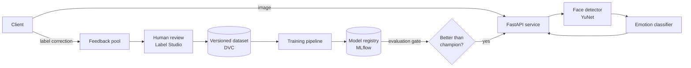

# face-analyzer

A face detection and emotion recognition service built to practise **MLOps**:
versioned data, tracked experiments, a model registry with an evaluation gate,
human-reviewed feedback, automated retraining, CI/CD and monitoring.

STATUS: Early development, not yet in working state

## What it does

Send an image → the service finds faces and estimates the expressed emotion for each one
(angry, disgust, fear, happy, sad, surprise, neutral).
Later versions add continuous valence/arousal and video input.

## Architecture

